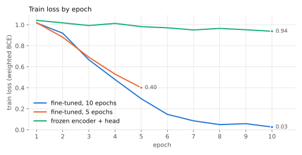
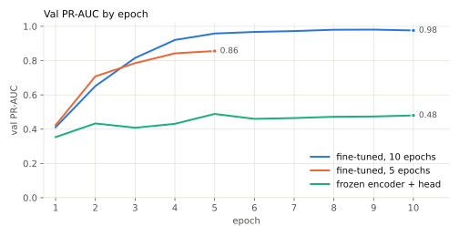
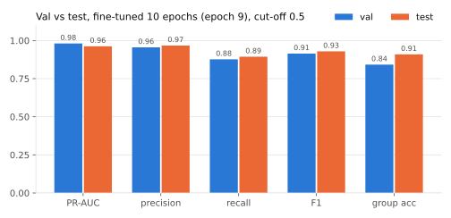
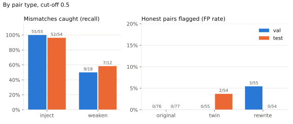
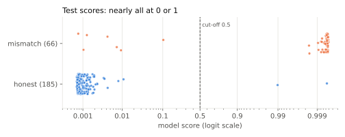
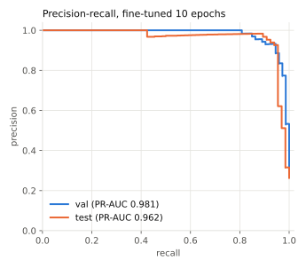

# Binary detector results: training, validation and test

Written 2026-11-03. Model: `checkpoints/binary` (GraphCodeBERT cross-encoder, fine-tuned for 10
epochs, best epoch 9). Test set: rung 1, `data/splits/full/test.jsonl`, **scored once**
(CARC job 13657576). Charts are made by `scripts/plot_results.py` from the committed files in
`checkpoints/`; rerun it to regenerate `docs/figures/`.

## Summary

- On held-out test tools the detector finds **59 of 66 mismatches** and raises **2 false
  alarms among 185 honest pairs**: precision 0.97, recall 0.89, F1 0.93, PR-AUC 0.962
  (95% interval 0.928–0.995). Every pair is right for 91% of test tools.
- Test agrees with val (PR-AUC 0.981, F1 0.91), so picking the epoch and cut-off on val didn't
  inflate the val numbers much.
- Fine-tuning is what makes it work. With the encoder frozen, the same head reaches only
  PR-AUC 0.489 on val.
- Injected operations are caught almost every time (52/54). **Weakened descriptions are the weak
  spot** (7/12): when an effect is removed from the description, the model often misses it.
- The 2 false alarms are honest twins. A hand check confirms the labels are right, so these are
  model errors (section 6).

## 1. Setup

| | |
|---|---|
| Data | `full`: 2,572 pairs from 763 tools, 26.8% mismatches. Split by tool: train 2,062 pairs (610 tools), val 259 (76), test 251 (77) |
| Pair types | original, `inject_code` (mismatch), honest twin that declares the injected effect, honest rewrite, `weaken_description` (mismatch) |
| Model | `microsoft/graphcodebert-base`, interface + code as one input, 2-layer head on `[CLS]`. Inputs over 512 tokens are split into overlapping chunks; the pair's score is the max over its chunks |
| Training | weighted BCE (`pos_weight` 2.75), AdamW lr 2e-5, effective batch 16 pairs, 10% warmup, 10 epochs, seed 566, one A100 |
| Model selection | epoch with the best val PR-AUC (epoch 9) |
| Cut-off | **0.5**, plus PR-AUC and the precision-recall curve, which cover every cut-off. The best-F1 cut-off on val (0.0035) is only a footnote under the test table |

## 2. Training

Three runs, all on the same train split:

- **fine-tuned, 10 epochs** (`checkpoints/binary`): the model we report.
- **fine-tuned, 5 epochs** (`checkpoints/binary_5ep`): the first run, stopped while still
  improving.
- **frozen encoder + head** (`checkpoints/binary_frozen`): the "before fine-tuning" baseline. Only
  the 2-layer head trains (lr 1e-3).





- **The loss chart is on the plain-BCE scale.** Training uses BCE with `pos_weight` 2.75, so
  each mismatch counts 2.75 times and the logged loss runs 1.47x plain BCE (it starts at 1.02,
  not 0.69). The chart divides the logged loss by 1.47, the mean pair weight in train. On this
  scale a model that gives every pair 0.5 scores ln 2 = 0.69 (dashed line). Logged values are in
  `checkpoints/*/metrics.json`.
- Fine-tuned train loss falls from 0.69 to 0.02. The frozen run barely moves (0.71 to 0.64),
  just below the "every score 0.5" line: the frozen encoder's `[CLS]` vector doesn't carry what
  the head needs.
- Val PR-AUC for the 10-epoch run by epoch: 0.41, 0.65, 0.82, 0.92, 0.96, 0.97, 0.97, 0.98,
  **0.98 (epoch 9, kept)**, 0.98. It flattens after epoch 8, so more epochs won't help.
- The 10-epoch run beats the 5-epoch run even at epoch 5 (0.958 vs 0.856). The learning rate
  decays over the whole run, so with 10 epochs it stays higher for longer.
- We have no metrics on the train set itself, only the loss: `train.py` scores val each epoch,
  not train. Train loss near 0.03 means the model fits train almost perfectly.

## 3. Validation (259 pairs, 76 tools)

Each run at its best epoch:

| Run | Cut-off | PR-AUC | P | R | F1 | Group acc |
|---|---|---|---|---|---|---|
| **fine-tuned, 10 ep** | **0.5** | **0.981** | **0.96** | **0.88** | **0.91** | **0.84** |
| fine-tuned, 5 ep | 0.5 | 0.856 | 0.78 | 0.81 | 0.79 | 0.63 |
| frozen + head | 0.5 | 0.489 | 0.34 | 0.71 | 0.46 | 0.17 |

10-epoch model at 0.5, by pair type: inject 55/55 caught, weaken 9/18 caught; flagged honest
pairs: original 0/76, twin 0/55, rewrite 3/55. Every injected effect class and every injection
position has recall 1.0. Weakened recall is low for `modify`, `relocate` (1/4 each) and
`send_outward` (1/3). Honest pairs flagged by chunk count (1 / 2 / 3+): 0.9% / 3.1% / 0%.

## 4. Test (251 pairs, 77 tools, scored once)



| Set | Cut-off | PR-AUC (95% CI) | P | R | F1 | Group acc | TP / FP / FN |
|---|---|---|---|---|---|---|---|
| **test** | **0.5** | **0.962** (0.928–0.995) | **0.97** | **0.89** | **0.93** | **0.91** | 59 / 2 / 7 |
| val | 0.5 | 0.981 (0.965–0.994) | 0.96 | 0.88 | 0.91 | 0.84 | 64 / 3 / 9 |

*Footnote: the best-F1 cut-off on val (0.0035) gives P 0.91 / R 0.95 / F1 0.93 on test (TP 63,
FP 6, FN 3): 4 more mismatches caught, 4 more false alarms, no F1 gain. It sits just above the
highest honest val score (0.0034), so it is fitted to one val pair. We report 0.5 and the
precision-recall curve instead.*

Test PR-AUC is 2 points below val but inside val's interval; F1 and group accuracy are a bit
higher. With 66 test mismatches, one pair moves recall by 1.5 points, so the two sets agree.



**By pair type** (cut-off 0.5):

| Pair type | Label | Test | Val |
|---|---|---|---|
| inject | mismatch | 52/54 caught | 55/55 |
| weaken | mismatch | 7/12 caught | 9/18 |
| original | honest | 0/77 flagged | 0/76 |
| twin | honest | 2/54 flagged | 0/55 |
| rewrite | honest | 0/54 flagged | 3/55 |

**Other breakdowns at 0.5:**

- **Effect class (injections):** recall 1.0 for every class except `relocate` (8/10). Weakened:
  `change_authority` 0/2, `destroy` 2/3, `modify` 1/2, `relocate` 1/2, `execute` 2/2,
  `spend` 1/1 (small counts).
- **Injection position:** recall 1.0 at middle, end and helper; 14/16 at start. Honest twins
  flagged: 2/8 at end, 0 elsewhere.
- **Chunks (1 / 2 / 3+):** recall 0.91 / 0.86 / 1.0; honest pairs flagged 0.8% / 1.9% / 0%.
  Longer inputs are not flagged more often, so the "more chunks means mismatch" leak we
  watched for doesn't show up.
- **Within a tool:** each injected mutant scores above every honest pair of its own tool
  (54/54); weakened 11/12. Almost all errors are scores that don't carry across tools.



**Scores are nearly all at 0 or 1.** 188 of 251 test scores are 0.01 or lower, 60 are 0.99 or
higher, and only 3 fall in between. So results at 0.5 barely depend on the exact cut-off: moving
it anywhere between 0.02 and 0.98 changes 1 test pair (a weakened pair at 0.10). A cut-off down in the honest
cluster, like the footnote's 0.0035, flips pairs on tiny score changes.



## 5. Errors on test at 0.5

**Missed mismatches (7):**

| Pair | Type | Score | Chunks |
|---|---|---|---|
| `c0083-0/inject-relocate-start` | inject | 0.0094 | 2 |
| `c0188-0/inject-relocate-start` | inject | 0.0073 | 2 |
| `c0083-0/weaken-destroy` | weaken | 0.1028 | 1 |
| `c0146-2/weaken-modify` | weaken | 0.0042 | 2 |
| `c0041-2/weaken-relocate` | weaken | 0.0008 | 2 |
| `c0188-0/weaken-change_authority` | weaken | 0.0010 | 1 |
| `c0190-1/weaken-change_authority` | weaken | 0.0013 | 1 |

- Both missed injections move a file at the start of the code and need 2 chunks. Tools `c0083-0`
  and `c0188-0` lose both their mismatches, so the misses cluster by tool.
- Three weakened pairs score about 0.001, the same as honest pairs, so no cut-off would catch
  them without also flagging honest pairs. More weakened training data might.

**False alarms (2):**

| Pair | Type | Score | Same tool's mutant |
|---|---|---|---|
| `c0106-2/twin-relocate-end` | twin | 0.9994 | 0.9995 |
| `c0145-1/twin-destroy-end` | twin | 0.9898 | 0.9994 |

## 6. Hand check of the two flagged twins

A twin has the mutant's code and a description that **does** state the added operation, so it
should be cleared. Both labels are right:

- **`c0145-1`, `run_attendee_import_job`.** The added code deletes the CSV after a successful
  import:

  ```python
  if p.returncode == 0 and os.path.isfile(csv_path):
      os.remove(csv_path)
  ```

  Twin description: "Imports guests from a CSV into an event, returns the log tail, **and deletes
  the CSV file if the import succeeds**." Exact match.

- **`c0106-2`, `buy_node_reserved_capacity`.** After buying the reservation, the added code moves
  a request file in S3 (`copy_object` from `capacity-requests/pending/<itype>.json` to
  `capacity-requests/processed/<itype>-<reservation id>.json`, then `delete_object`). Twin
  description: "…purchases it. **Then moves the instance type's pending capacity request file in
  S3 to the processed folder, renamed with the reservation id.**" Exact match. (The twin leaves
  out the "not purchased, with a reason" return value, but that is a return value, not an
  effect.)

So these are model errors. In both tools the twin scores almost exactly what the mutant scores,
so for these two tools the model reacts to the added code and barely reads the description. In
both, the added operation sits at the end of the code and is declared in a trailing sentence.
The 5-epoch model's flagged val twins (hand-checked 2026-10-29) had the same shape.

## 7. Takeaways and next steps

- The detector works on held-out tools from the same generator: F1 0.93 at a fixed 0.5 cut-off,
  with almost no false alarms on originals and rewrites.
- **Weakened mismatches** are the main gap (7/12 test, 9/18 val). There are only 129 in the
  whole dataset. Generating more is the most direct fix.
- **Twins with a trailing declared operation** can still fool the model. Worth a check across
  train: are twins with the declared effect at the end rarer than mutants with code at the end?
- This is rung 1 only. Rung 2 (a different generator) tests whether the model learned the
  generator's style; rung 3 (real tools) tests whether it transfers to real code. Then run Agent
  Audit on the coverage set.

## Files

- Model runs: `checkpoints/{binary,binary_5ep,binary_frozen}/` (metrics, val predictions,
  threshold, config). Weights are on CARC only.
- Test results: `checkpoints/binary/eval/full-test/{metrics.json,predictions.jsonl}`.
- Job logs: `runs/slurm-agentlint-{13535509,13535510,13589508}.out` (training),
  `runs/slurm-agentlint-score-13657576.out` (test scoring).
- Charts: `scripts/plot_results.py` → `docs/figures/` (install with `pip install -e ".[plots]"`).
