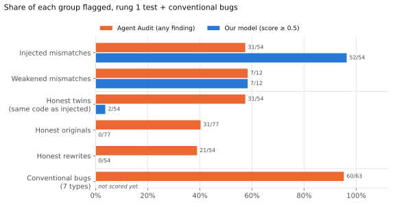

# Coverage: our detector vs Agent Audit

Written 2026-11-07. Compares our binary detector (`checkpoints/binary`, the model in
`docs/results-binary.md`) with **Agent Audit v0.19.2**, the rule-based scanner from the course
staff and the project's only baseline. The question is coverage: which kinds of problem each
tool catches, and how often each raises an alarm on code with no problem. Numbers come from
`agentlint coverage {audit,report} configs/coverage.yaml`
(`data/coverage/coverage.{json,md}`); the chart is made by `scripts/plot_results.py`.

**Status:** our model has not scored the 63 conventional-bug tools yet (a CARC job). Its
column for them is empty below, and the conclusion about the union waits on that number.

## Summary

- **Agent Audit does not detect capability mismatches.** On every pair where the code is the
  same and only the description differs (54 injected mismatches vs their honest twins, 12
  weakened mismatches vs their originals), its findings are **identical, 66 of 66**. It flags
  57% of injected mismatches, and also 57% of their honest twins.
- **Our model separates those same pairs:** it flags 52/54 injected mismatches and 2/54 twins.
- **Agent Audit's alarms on our test pairs come mostly from three generic rules** (no input
  validation, no error handling, LangChain input not sanitized). It raises them on 40% of
  honest original tools. Without those three rules it flags 16/54 injections and 14/77
  honest originals, again with no difference between a mismatch and its twin.
- **Agent Audit does catch conventional bugs:** 60 of 63 tools with an eval, shell injection,
  SQL injection, unsafe deserialization, hardcoded secret, path traversal or SSRF bug have at
  least one finding. Its bug-specific rules fire reliably on eval/exec (9/9), shell injection
  (9/9) and hardcoded secrets (7/9), but rarely on SQL injection (1/9), SSRF (1/9), path
  traversal (0/9) and unsafe deserialization (0/9); those are caught only through the generic
  rules.
- So the two tools cover different problems: Agent Audit covers unsafe code, ours covers code
  that does more than it says.

## 1. Setup

| | |
|---|---|
| Mismatch and honest cases | All 251 pairs of rung 1 `test` (77 tools): 54 injected and 12 weakened mismatches, 77 originals, 54 honest twins, 54 honest rewrites. Our model's predictions are the ones from the one-time test scoring on 2026-11-03 (CARC job 13657576) |
| Conventional bugs | 63 tools written by Claude Sonnet 5.5, 9 per bug type: eval/exec of input, shell injection, SQL injection, unsafe deserialization, hardcoded secret, path traversal, SSRF. Each description is accurate; each bug is confirmed by an AST check (`src/agentlint/data/bugs.py`). File: `data/generated/coverage-bugs/pairs.jsonl` |
| Agent Audit | v0.19.2, `scan --severity info --min-tier info`: every finding at any severity. Each case is one file under a neutral path (Agent Audit suppresses findings in test-looking paths) with its description restored as the tool's docstring |
| "Caught" | Agent Audit: the case has **any** non-suppressed finding (team decision, the most generous rule for it). Our model: score ≥ 0.5 |

## 2. Results by group

| Group | n | Agent Audit | Our model @0.5 | Either | Both |
|---|---|---|---|---|---|
| Injected mismatches | 54 | 31 (57%) | 52 (96%) | 53 | 30 |
| Weakened mismatches | 12 | 7 (58%) | 7 (58%) | 9 | 5 |
| Honest twins (same code as injected) | 54 | 31 (57%) | 2 (4%) | 32 | 1 |
| Honest originals | 77 | 31 (40%) | 0 | 31 | 0 |
| Honest rewrites | 54 | 21 (39%) | 0 | 21 | 0 |
| Conventional bugs | 63 | 60 (95%) | not scored yet | | |

For the honest groups every flag is a false alarm. "Either" on a mismatch group is what the
two tools catch together; on an honest group it is how many false alarms the pair would raise.

### Same code, different description

Our test set is built from minimal pairs: an injected mismatch and its honest twin have
**byte-identical code** and differ only in whether the description declares the injected
operation; a weakened mismatch and its original have identical code and differ only in one
removed effect. A tool that reads the description against the code must treat them
differently.

| Pair | Pairs | Agent Audit: identical findings | Our model: flags mismatch, not honest |
|---|---|---|---|
| injected / honest twin | 54 | 54 | 50 |
| weakened / original | 12 | 12 | 7 |

This matches the earlier probes (CLAUDE.md section 8): Agent Audit extracts the docstring but
no rule compares it to what the code does.

### Which Agent Audit rules fire

| Rule | Title | Injected | Twin | Original | Bugs |
|---|---|---|---|---|---|
| AGENT-034 | Tool function without input validation | 17 | 17 | 14 | 41 |
| AGENT-022 | No error handling in tool execution | 9 | 9 | 16 | 35 |
| AGENT-026 | LangChain tool input not sanitized | 8 | 8 | 8 | 29 |
| AGENT-111 | Internal hostname exposed in code | 9 | 9 | 3 | 1 |

Counts are cases with at least one finding of that rule. The first three describe code style
and fire alike on honest and mismatched code. Without them, Agent Audit flags 16/54 injected
mismatches, 16/54 twins, 1/12 weakened mismatches and 14/77 honest originals.

### Conventional bugs by type

| Bug type | n | Any finding | Bug-specific rule | Main rules |
|---|---|---|---|---|
| eval / exec of input | 9 | 9 | 9 | AGENT-001, AGENT-017, AGENT-035 |
| shell injection | 9 | 9 | 9 | AGENT-035, AGENT-001 |
| hardcoded secret | 9 | 9 | 7 | AGENT-004 |
| SQL injection | 9 | 9 | 1 | AGENT-034 (generic); AGENT-041 once |
| SSRF | 9 | 9 | 1 | AGENT-022, AGENT-026 (generic); AGENT-020 once |
| path traversal | 9 | 8 | 0 | AGENT-026, AGENT-034 (generic) |
| unsafe deserialization | 9 | 7 | 0 | AGENT-022, AGENT-034 (generic) |

"Bug-specific rule" counts a finding from any rule other than the three generic ones above.
Four made-up secrets had real provider prefixes (Stripe, Google, SendGrid); they were renamed
so GitHub's push protection would accept the file, and AGENT-004 still fires on 7/9.

## 3. What this means for the write-up

- Frame Agent Audit as **complementary coverage**, as planned (CLAUDE.md section 5,
  "Evaluation"): it targets unsafe code, our detector targets interface/implementation
  mismatches, and neither substitutes for the other.
- The strongest single piece of evidence is the minimal-pair table: identical findings on 66 of
  66 same-code pairs.
- Report Agent Audit with and without its three generic rules; under "any finding" its catches
  on mismatches are matched by the same rate of false alarms.

## 4. Limits

- Rung 1 only: generated tools from the training generator (Sonnet). Rungs 2–3 are not in the
  comparison yet.
- The bug tools are LLM-written and short; real code may trip Agent Audit's rules differently.
- 63 bugs, 9 per type: per-type rates are rough.
- Our model's column for the bug tools is still missing (CARC). To fill it:
  `sbatch -A yzhao010_1531 --gres=gpu:a100:1 scripts/carc/score.slurm checkpoints/binary data/generated/coverage-bugs/pairs.jsonl`,
  then `agentlint coverage report configs/coverage.yaml` and `python scripts/plot_results.py`.
