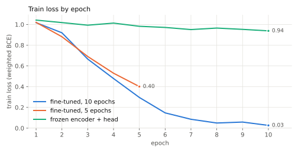
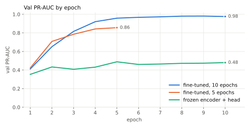
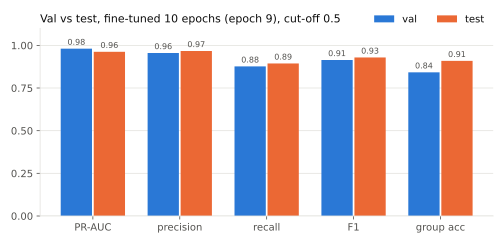
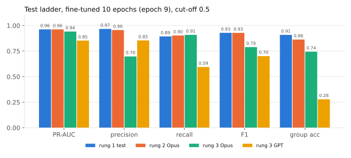
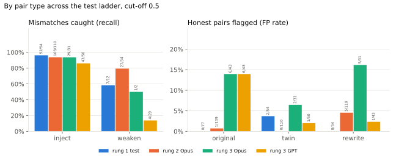
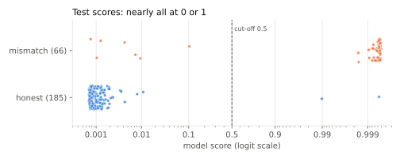
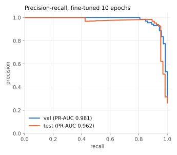
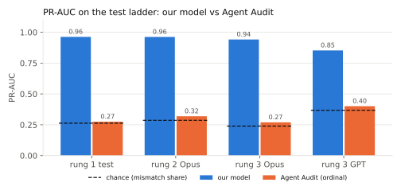
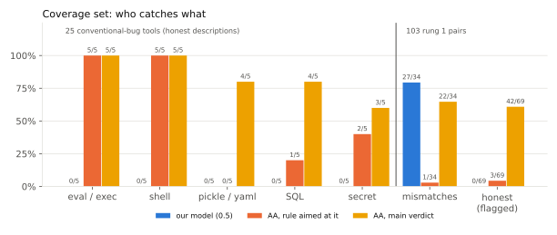

# AgentLint: final results and takeaways

Written 2026-11-18, after every planned run. This page collects the final numbers in one
place. Details and per-run analysis are in `docs/results-binary.md` (our model) and
`docs/results-agent-audit.md` (Agent Audit). Every number here comes from saved predictions;
nothing was rescored for this page. Charts are regenerated with
`python scripts/plot_results.py` (`plots` extra), which also prints the numbers.

## The verdict in one paragraph

A fine-tuned code model can learn to check that an agent tool's code matches its declared
interface (name, parameters, description). It reaches PR-AUC 0.96 on held-out tools and on
tools from a different generator, and 0.85–0.94 on real GitHub code with injected
capabilities. Agent Audit, the rule-based baseline, cannot detect these mismatches at all: its
rules never use the description, so its ranking is at chance on every set. Agent Audit does
catch conventional bugs (eval, shell injection), which our model by design does not. The two
tools catch different problems and complement each other rather than compete.

## 1. Task and setup

**Task.** Flag a tool whose code does more than its interface says. Example: a tool described
as "list the files in a project folder" whose code also moves the folder. The code is fine
alone, the description is fine alone; only the pair is wrong.

**Effect classes (7):** modify, destroy, relocate, send outward, execute, spend, change
authority.

| | |
|---|---|
| Model | `microsoft/graphcodebert-base` cross-encoder, standard RoBERTa 2-layer head on `[CLS]`, binary output |
| Input | name + compact params + description, then code with whitespace collapsed; chunks of 512 tokens (128 overlap), max-pooled logits; never truncated |
| Training | BCE with `pos_weight` ~2.7, AdamW lr 2e-5, 10 epochs, effective batch 16, fp16, seed 566, USC CARC A100 |
| Model selection | best val PR-AUC (epoch 9 of 10); `test` never read during training |
| Cut-off | 0.5 for every test set (saved best-F1 cut-off 0.0035 only as a footnote) |
| Baseline | Agent Audit 0.19.2, one scan per set, fixed verdict rules written down before the first run |

**Training data (`full`).** 2,572 description + code pairs from 763 tools written by Claude
Sonnet 5.5, 689 mismatches (26.8%). Each tool yields up to 5 pairs: the original (honest), an
injected mismatch (an undeclared operation added to the code), its honest twin (same code, the
description declares the operation), an honest rewrite (original code, the injected pair's
description style), and a weakened mismatch (original code, a declared effect removed from the
description). The same code appears with both labels and so does the same description style,
so only the pair decides the label. Split by tool: train 2,062 / val 259 / test 251.
Shortcut check: description-length-only 72.6% and description-words-only 74.2%, against 73.2%
for always guessing honest.

**Test ladder** (each scored once):

| Set | What it tests | Pairs | Tools | Mismatches |
|---|---|---|---|---|
| rung 1 `test` | held-out tools, same generator (Sonnet) | 251 | 77 | 66 |
| rung 2 | different generator (Opus 5.5) and seed | 503 | 139 | 144 |
| rung 3 Opus | 43 real GitHub tools, our injection pipeline (Opus) | 138 | 43 | 33 |
| rung 3 GPT | the same 43 tools, templated injections (GPT-5.6) | 215 | 43 | 79 |
| coverage set | 25 conventional-bug tools + 25 rung 1 tools | 128 | 50 | 34 (+25 bugs) |

## 2. Training

| Run | Best epoch | Val PR-AUC (95% CI) | P | R | F1 | Group acc |
|---|---|---|---|---|---|---|
| **fine-tuned, 10 epochs** (`binary`) | 9 | **0.981** (0.965–0.994) | 0.96 | 0.88 | 0.91 | 0.84 |
| fine-tuned, 5 epochs | 5 | 0.856 (0.82–0.90) | 0.78 | 0.86 | 0.82 | 0.67 |
| frozen encoder + trained head | 5 | 0.489 (0.45–0.55) | 0.45 | 0.59 | 0.51 | 0.33 |

The 10-epoch run is at 0.5; the two older runs are at their own best-F1 cut-offs. PR-AUC by
epoch for the 10-epoch run: 0.411, 0.651, 0.816, 0.920, 0.958, 0.967, 0.972, 0.980, 0.981,
0.976, so it has levelled off. **Fine-tuning the encoder is what makes it work:** the frozen
encoder reaches only 0.49.

## 3. Our model on the test ladder

| Set | PR-AUC (95% CI, tool bootstrap) | P | R | F1 | Group acc | TP / FP / FN |
|---|---|---|---|---|---|---|
| val | 0.981 (0.965–0.994) | 0.96 | 0.88 | 0.91 | 0.84 | 64 / 3 / 9 |
| **rung 1 `test`** | **0.962** (0.928–0.995) | 0.97 | 0.89 | 0.93 | 0.91 | 59 / 2 / 7 |
| **rung 2** Opus | **0.962** (0.942–0.981) | 0.96 | 0.90 | 0.93 | 0.86 | 130 / 6 / 14 |
| **rung 3** Opus | **0.942** (0.886–0.986) | 0.70 | 0.91 | 0.79 | 0.74 | 30 / 13 / 3 |
| **rung 3** GPT | **0.853** (0.811–0.898) | 0.86 | 0.60 | 0.70 | 0.28 | 47 / 8 / 32 |

All at 0.5. Group accuracy = share of tools where every pair is right; it is the hardest
number to get by a shortcut. Footnotes:
- At the saved cut-off 0.0035, F1 is 0.93 / 0.91 / 0.78 / 0.74 for rungs 1 / 2 / 3 Opus /
  3 GPT, so it gives no clear gain.
- Rung 3 GPT without its 9 weakened pairs that remove `read` (not a mismatch under our
  definition): 206 pairs, PR-AUC 0.856 (0.804–0.907), F1 0.73, group acc 0.44.

**By pair type, at 0.5:**

| Pair type | val | rung 1 | rung 2 | rung 3 Opus | rung 3 GPT |
|---|---|---|---|---|---|
| inject recall | 55/55 | 52/54 | 103/110 | 29/31 | 43/50 |
| weaken recall | 9/18 | 7/12 | 27/34 | 1/2 | **4/29** |
| original flagged | 0/76 | 0/77 | 1/139 | **6/43** | **6/43** |
| twin flagged | 0/55 | 2/54 | 0/110 | 2/31 | 1/50 |
| rewrite flagged | 3/55 | 0/54 | 5/110 | 5/31 | 1/43 |

**Scores are near 0 or 1.** On rung 1, 188 of 251 pairs score at most 0.01 and 60 score at
least 0.99, so results barely depend on the exact cut-off.

**Chunk leak check.** Mismatches are longer, so more chunks could mean "mismatch". On rung 1
the honest false-alarm rate by chunk count (1 / 2 / 3+) is 0.8% / 1.9% / 0%; on rung 2 it is
1.4% / 2.1% / 1.4%. No leak.

## 4. Agent Audit vs our model

| Set | AA P | AA R | AA F1 | AA group acc | AA PR-AUC (ordinal; 95% CI) | Chance | Ours PR-AUC | Ours F1 |
|---|---|---|---|---|---|---|---|---|
| rung 1 | 0.30 | 0.62 | 0.40 | 0.16 | 0.275 (0.252–0.299) | 0.263 | 0.962 | 0.93 |
| rung 2 | 0.33 | 0.61 | 0.43 | 0.09 | 0.319 (0.298–0.340) | 0.286 | 0.962 | 0.93 |
| rung 3 Opus | 0.29 | 0.45 | 0.35 | 0.19 | 0.270 (0.239–0.314) | 0.239 | 0.942 | 0.79 |
| rung 3 GPT | 0.41 | 0.54 | 0.47 | 0.00 | 0.401 (0.382–0.418) | 0.367 | 0.853 | 0.70 |

AA at its main verdict (any non-suppressed BLOCK or WARN finding). Chance = share of
mismatches in the set.

- **AA cannot see a mismatch.** Pairs with identical code got identical AA findings in all
  543 same-code groups (496 on the rungs, 47 on the coverage set). Given an injected mismatch
  and its honest twin, AA ties 245/245; our model scores the mismatch higher 245/245. For
  weakened pairs against same-code honest pairs, AA ties 141/141; ours is higher in 121, tied
  in 1, lower in 19 (17 of those on rung 3 GPT).
- **AA's recall is not detection.** It flags 38–55% of all pairs, mostly through generic rules
  (AGENT-034 input validation, AGENT-022 error handling, AGENT-026) that fire on honest code
  just as often. On every set its recall on injections equals its false-alarm rate on their
  twins. Counting only its rules for dangerous operations, recall is 0.06 / 0.18 / 0.12 / 0.28.
- **Rung 3 GPT is slightly above chance** only because the templates add code AA treats as
  dangerous (AGENT-035 on 43 pairs). The honest twins carry the same code and are flagged just
  as often.

**Coverage on the rungs** (AA main verdict, our 0.5):

| Set | Mismatches | Ours only | AA only | Both | Neither | Honest flagged: ours / AA |
|---|---|---|---|---|---|---|
| rung 1 | 66 | 22 | 4 | 37 | 3 | 2 / 97 |
| rung 2 | 144 | 51 | 9 | 79 | 5 | 6 / 180 |
| rung 3 Opus | 33 | 16 | 1 | 14 | 2 | 13 / 37 |
| rung 3 GPT | 79 | 13 | 9 | 34 | 23 | 8 / 63 |

Adding AA to our model would catch 23 more mismatches across the four sets but add 365 honest
false alarms. Given the same-code result, those extra catches are coincidence.

## 5. Coverage set: conventional bugs

25 hand-written tools with a conventional bug (5 each: eval / exec, `shell=True`, unsafe
pickle / yaml, string-built SQL, hard-coded secret), all with honest descriptions, plus 25
rung 1 tools with all their pairs (103 pairs, 34 mismatches).

| Bug kind | AA, rule aimed at the bug | AA main verdict | Ours at 0.5 |
|---|---|---|---|
| eval / exec | **5/5** (AGENT-001, 017, 035) | 5/5 | 0/5 |
| `shell=True` / `os.system` | **5/5** (AGENT-035; AGENT-001 on 4) | 5/5 | 0/5 |
| unsafe pickle / yaml | **0/5** | 4/5 | 0/5 |
| string-built SQL | **1/5** (AGENT-041) | 4/5 | 0/5 |
| hard-coded secret | **2/5** (AGENT-004) | 3/5 | 0/5 |
| **all 25 bugs** | **13/25** | 21/25 | **0/25** |
| rung 1 mismatches (34) | 1/34 | 22/34 | **27/34** |
| rung 1 honest flagged (69) | 3/69 | 42/69 | **0/69** |

- **Our model flags none of the bugs** (highest score 0.0025). That is correct under our
  definition (the descriptions are honest), and it means our model gives no protection against
  these bugs.
- **AA is strong on code and shell execution and weak elsewhere.** Its main verdict reaches
  21/25 only through the generic rules, which also flag 61% of honest rung 1 pairs.
- The bug-specific rules fire on one rung 1 tool, `c0094-2`, which hard-codes a placeholder
  Stripe key: AGENT-004 flags all 4 of its pairs. That is a real secret finding, unrelated to
  the mismatch, and the only overlap between the two tools. With AA's capability-rules
  verdict, AA catches 11/25 bugs and flags 0 of the 103 rung 1 pairs.

## 6. Takeaways

1. **The task is learnable, and fine-tuning is required.** Fine-tuned GraphCodeBERT goes from
   0.49 (frozen encoder) to 0.98 val PR-AUC, and holds 0.96 on the untouched test set.
2. **The model compares description and code; it doesn't use surface cues.** It ranks every
   injected mismatch above its same-code honest twin (245/245), and length- and
   description-only baselines are at the majority rate.
3. **It generalizes across generators.** Rung 2 (Opus, new seed) matches rung 1 exactly
   (PR-AUC 0.962, F1 0.93), so the model did not learn Sonnet's writing style.
4. **Real code costs precision, not recall on injections.** On real GitHub tools, injections
   are still caught (29/31 and 43/50), but 6/43 honest originals are flagged in both versions.
   A hand check found all 6 are model errors. Real docstrings imply effects through the verb
   ("search", "control the light"); our training descriptions name every effect, so the model
   flags `requests.post`, `subprocess.run` or `client.publish` that the description doesn't
   spell out. The same code with a fuller description clears in most cases.
5. **Weakened mismatches are the main weak spot.** Recall is 7/12 (rung 1), 27/34 (rung 2) and
   4/29 (rung 3 GPT). Missed pairs score like honest ones (~0.001), so a lower cut-off won't
   help; more weakened training data would (only 129 of 2,572 training pairs).
6. **Agent Audit answers a different question.** It asks "is this code dangerous?", we ask
   "does this code do more than its interface says?". On our question it is at chance, and the
   same-code check shows why: it never uses the description.
7. **The two tools are complementary.** AA catches conventional bugs (best on eval and shell,
   weak on SQL, secrets and deserialization); our model catches mismatches with few false
   alarms. Running both is the sensible setup.

## 7. Limitations

- **Synthetic mismatches.** Every mismatch is injected or weakened on purpose; no mismatch was
  found in the wild (rung 4 was dropped for time).
- **Rung 3 is small** (43 tools) and its intervals are wide (Opus 0.886–0.986). Its weakened
  results from the Opus version rest on only 2 pairs.
- **Rung 3 GPT uses templates,** so repeated operations and wording may be a shortcut; its
  provenance (repository, commit, license) is still incomplete.
- **Scores are not calibrated probabilities:** they sit near 0 or 1, and `pos_weight` tilts
  them toward flagging.
- **`read` is not covered:** a tool that returns more data than it says is a known blind spot.
- **The model says whether, not where.** Line numbers in reports would come from the AST
  locator, which needs the word-list gaps (SQL-table effects, `stripe.PaymentIntent.create`)
  fixed first.
- **The model is binary;** the planned multi-label version (one output per effect class) was
  not trained.

## 8. If there were more time

1. Train on more weakened mismatches (the clearest weak spot).
2. Add honest tools with short, implicit descriptions, like real docstrings, to cut false
   alarms on real code.
3. Train the multi-label model so a report can say which effect is undeclared.
4. Fix the word-list gaps so reports point at the right lines.
5. Data-flow input via tree-sitter, as an ablation.

## Files

- Our model: `checkpoints/binary/` (`metrics.json`, `threshold.json`, `val_predictions.jsonl`),
  `checkpoints/binary/eval/{full-test,rung2-opus-pairs,rung3-opus,rung3-gpt,coverage-bugs}/`.
- Agent Audit: `runs/agent_audit/{full-test,rung2-opus,rung3-opus,rung3-gpt,coverage}/`.
- CARC logs: `runs/slurm-agentlint-*.out`.
- Charts: `docs/figures/`, from `scripts/plot_results.py`.
- Details: `docs/results-binary.md`, `docs/results-agent-audit.md`,
  `docs/agent-audit-comparison.md`.
